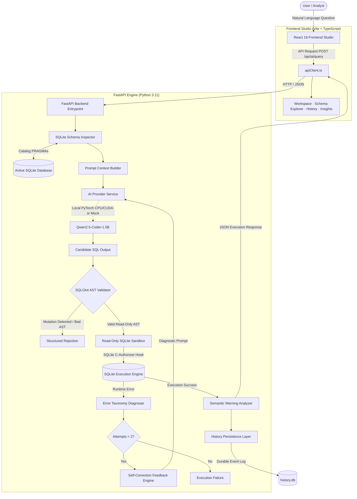
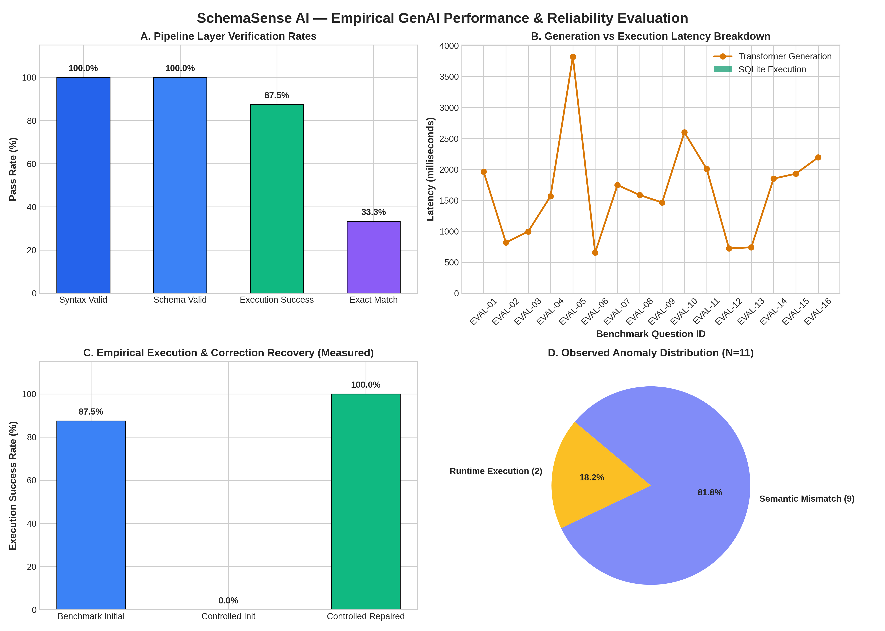

# SchemaSense AI

> **Natural Language. Precise SQL.**  
> *Schema-Aware SQL Query Generation with Automatic Self-Correction Using Generative AI*  
>
> **Academic Project:** Generative Artificial Intelligence (22CSE73) — Alternate Assessment Tool 1 (AAT-1)  
> **Institution:** Department of Computer Science and Engineering, New Horizon College of Engineering, Bengaluru  
> **Repository:** [https://github.com/ameer0508/SchemaSense-AI](https://github.com/ameer0508/SchemaSense-AI)

---

## Table of Contents

1. [Project Overview](#1-project-overview)
2. [Key Capabilities](#2-key-capabilities)
3. [System Architecture](#3-system-architecture)
   - [Local Application Architecture (FastAPI & React)](#local-application-architecture-fastapi--react)
   - [Google Colab Experimental Architecture (Standalone GPU Evaluation)](#google-colab-experimental-architecture-standalone-gpu-evaluation)
4. [Technology Stack](#4-technology-stack)
5. [Repository Structure](#5-repository-structure)
6. [How SchemaSense AI Works](#6-how-schemasense-ai-works)
7. [Academic Dataset: Campus Intelligence](#7-academic-dataset-campus-intelligence)
8. [Performance & Empirical Evaluation](#8-performance--empirical-evaluation)
   - [Cryptographic Evidence Verification](#cryptographic-evidence-verification)
   - [Verified Baseline Benchmark Results](#verified-baseline-benchmark-results)
   - [Evaluation Metrics & Latency Summary](#evaluation-metrics--latency-summary)
   - [Empirical Visualizations](#empirical-visualizations)
   - [Academic Transparency: Semantic Accuracy vs. Execution](#academic-transparency-semantic-accuracy-vs-execution)
9. [Defensive Guardrails & Security Design](#9-defensive-guardrails--security-design)
10. [Local Setup & Installation](#10-local-setup--installation)
    - [Prerequisites](#prerequisites)
    - [Backend Setup (FastAPI & Engine)](#backend-setup-fastapi--engine)
    - [Frontend Setup (React Studio)](#frontend-setup-react-studio)
    - [Local Development Configuration](#local-development-configuration)
11. [Google Colab Reproduction Guide](#11-google-colab-reproduction-guide)
12. [Testing & Verification Suite](#12-testing--verification-suite)
13. [Limitations & Future Roadmap](#13-limitations--future-roadmap)
14. [Academic Context & Authorship](#14-academic-context--authorship)
15. [License & Usage Terms](#15-license--usage-terms)

---

## 1. Project Overview

Relational databases store the operational core of modern enterprises, yet querying them requires specialized knowledge of SQL, dialect nuances, schema constraints, and foreign-key join paths. While generative Large Language Models (LLMs) can synthesize code from human instructions, naive text-to-SQL approaches suffer from high failure rates when applied to real databases:

1. **Hallucination of Schemas:** Models frequently invent non-existent column and table names, or assume standard columns (such as `age` or `student_name`) that do not exist in the underlying physical schema.
2. **Syntactic and Semantic Incompatibilities:** Queries generated without dialect grounding fail on engine-specific function signatures, groupings, or type casts.
3. **Cartesian Inflation:** Multi-table joins across 1-to-many relationships without proper grouping or projection keys silently produce multiplicative row duplications, yielding incorrect quantitative answers despite error-free execution.
4. **Safety & Mutation Vulnerabilities:** Unconstrained model output poses severe security hazards if queries contain mutating operations (`DROP`, `DELETE`, `UPDATE`, `ALTER`, `ATTACH`).

**SchemaSense AI** addresses these challenges through a **schema-grounded, multi-tier validated, execution-guided self-correction architecture**. Rather than relying on open-ended generation, SchemaSense AI dynamically inspects the relational catalog of an active SQLite database, binds schema metadata directly into structured ChatML prompts, evaluates generated SQL using Abstract Syntax Tree (AST) analysis via SQLGlot, runs candidate queries in a sandboxed SQLite environment with a native C-level authorizer, and autonomously repairs syntax and schema errors using diagnostic compiler feedback.

### Architectural Separation
To ensure total academic transparency, this repository clearly distinguishes two execution workflows:
- **The Standalone Google Colab Implementation:** A self-contained, GPU-accelerated experimental environment running the open-weight `Qwen/Qwen2.5-Coder-1.5B-Instruct` model, conducting benchmark evaluations, plotting publication figures, and exporting cryptographic verification archives.
- **The Local Full-Stack Web Application:** A developer studio featuring a React 19 / TypeScript 5.8 frontend and a FastAPI backend with dynamic schema exploration, query execution, history auditing, telemetry analytics, and pluggable local transformer/mock inference providers.

---

## 2. Key Capabilities

### Natural-Language SQL Translation
- **Zero-Shot English-to-SQL:** Converts human analytical questions into precise SQLite 3 queries.
- **Strict Schema Conditioning:** Delimits verified tables, data types, primary keys, and foreign keys directly within the system prompt context.
- **Dialect Specialization:** Enforces SQLite-specific syntax, string concatenation, date functions, and grouping behaviors.

### Schema Intelligence
- **Dynamic Introspection:** Scans relational catalogs at runtime without hardcoded table structures.
- **Relationship Discovery:** Extracts primary key-foreign key graph edges to guide join formulation.
- **Context Serialization:** Deterministically serializes schema metadata to ensure consistent, reproducible prompt contexts.

### SQL Safety & Reliability
- **SQLGlot AST Static Analysis:** Parses queries into syntactic abstract trees before execution. Mutating statements (`INSERT`, `UPDATE`, `DELETE`, `DROP`, `ALTER`, `CREATE`, `PRAGMA`) are blocked immediately.
- **Column Hallucination Detection:** Compares AST column tokens against known schema columns, detecting fabricated attributes before reaching the database engine.
- **SQLite C-Authorizer Sandbox:** Attaches a low-level engine callback (`set_authorizer`) to the SQLite C-interface, denying write, attach, or alter permissions at the engine layer.
- **VM Instruction Limiting:** Employs `set_progress_handler` to intercept runaway queries after 500,000 instructions, mitigating infinite loops and Cartesian explosions.
- **Execution-Guided Self-Correction:** When execution triggers a syntax or schema error, a structured diagnostic prompt delivers compiler feedback back to the generative engine for automated iterative repair (up to 2 attempts).
- **Conservative Semantic Warning Engine:** Audits multi-table joins to detect 1-to-many cardinality risks and flags `POTENTIALLY_MULTIPLICATIVE_JOIN` warnings when row counts inflate without grouping keys.

### User Experience Studio (React 19 & TypeScript)
- **Interactive Query Workspace:** Natural language prompt input with query suggestions and real-time inference timer.
- **Multi-Tab Verification Surface:** Tabular query result display, AST-verified generated SQL viewer, and multi-turn correction trace timeline.
- **Dynamic Schema Explorer:** Interactive visual browser for database tables, column specifications, and live data previews.
- **Durable Query History:** Local parameterized audit log with full-text search, execution status filtering, and query re-execution.
- **Telemetry & Insights:** Server-side aggregated reliability metrics, pass rates, latency distributions, and error taxonomies.

---

## 3. System Architecture

### Local Application Architecture (FastAPI & React)

The local application operates as a decoupled client-server system with layered validation and defense-in-depth:



### Google Colab Experimental Architecture (Standalone GPU Evaluation)

The Google Colab notebook (`backend/notebooks/SchemaSense_AI_GenAI_AAT1.ipynb`) runs independently in a cloud environment:

```mermaid
flowchart LR
    subgraph Colab ["Google Colab Runtime (Tesla T4 GPU / CPU)"]
        NB[SchemaSense_AI_GenAI_AAT1.ipynb] --> Seed[Seed Synthetic Campus DB]
        Seed --> IntrospectColab[Dynamic Schema Introspection]
        IntrospectColab --> ModelLoad[Load Qwen2.5-Coder-1.5B-Instruct]
        ModelLoad --> Bench[Run 16-Question Benchmark Suite]
        
        Bench --> Pipeline["Generate → AST Validate → Execute → Self-Correct"]
        Pipeline --> Metrics[Compute 5-Metric Evaluation Taxonomy]
        Metrics --> Plots[Render 4-Panel Matplotlib Visualizations]
        Plots --> Exporter[Package Cryptographic Evidence ZIP]
    end

    Exporter --> Artifacts[SchemaSense_AI_Colab_Evidence_*.zip]
```



---

## 4. Technology Stack

| Layer | Component | Verified Technology | Implementation Purpose |
|---|---|---|---|
| **Frontend** | UI Framework | **React 19.3.1** | Component architecture and reactive rendering |
| **Frontend** | Language | **TypeScript 5.8.2** | End-to-end type safety and compile-time contract enforcement |
| **Frontend** | Build Tooling | **Vite 6.1.2** | Hot module replacement and production tree-shaking |
| **Frontend** | Styling | **Tailwind CSS 4.3.3** | Responsive, dark/light design token architecture |
| **Frontend** | Server State | **TanStack Query 5.105.0** | Asynchronous state management, query caching, and polling |
| **Frontend** | Icons | **Lucide React 1.61.0** | Accessible vector symbology |
| **Backend** | Web Framework | **FastAPI 0.115.0+** | Asynchronous OpenAPI-documented REST API |
| **Backend** | Validation | **Pydantic 2.8.0+** | Request/response schema validation and type coercion |
| **Backend** | ASGI Server | **Uvicorn 0.30.0+** | High-performance asynchronous HTTP server |
| **Backend** | SQL Engine | **SQLGlot 25.0.0+** | AST parsing, token inspection, and mutation blocking |
| **Database** | Relational Store | **SQLite 3 (Built-in)** | Primary evaluation and demonstration database engine |
| **Database** | History Store | **SQLite 3 WAL Mode** | Parameterized query audit logging in `backend/data/history.db` |
| **Generative AI** | Model | **Qwen2.5-Coder-1.5B-Instruct** | 1.54B parameter open-weight autoregressive code model |
| **Generative AI** | Framework | **Transformers 4.40.0+** | Causal language modeling and pipeline tokenization |
| **Generative AI** | Deep Learning | **PyTorch 2.2.0+** | Hardware-accelerated tensor arithmetic (bfloat16/float32) |
| **Academic** | Notebook Tool | **nbformat 5.9.0+** | Programmatic Jupyter notebook generation and validation |
| **Academic** | Analytics | **pandas 2.0.0+** | Multiset execution comparison and tabular evaluation |
| **Academic** | Plotting | **Matplotlib 3.8.0+** | 4-panel publication visualization rendering |
| **Academic** | Documentation | **python-docx & reportlab** | Automated 17-page Word and publication PDF generation |
| **Testing** | Test Suite | **Pytest 8.3.0+** | Automated testing (167 tests passing) |
| **Testing** | Static Analysis | **Oxlint 1.88.0+** | Rust-based high-performance JavaScript/TypeScript linter |

---

## 5. Repository Structure

```text
SchemaSense AI/
├── frontend/                                   # Client Application Studio
│   ├── public/                                 # Static vector assets (favicon.svg, icons.svg)
│   ├── src/
│   │   ├── assets/                             # Visual branding assets
│   │   ├── components/
│   │   │   ├── common/                         # BrandLogo, ThemeToggle, ConnectionBadge, ErrorBoundary
│   │   │   ├── composer/                       # QuestionComposer, SampleSuggestions
│   │   │   ├── database/                       # DatabaseSelector, DatabaseUploadModal, TableDataPreview
│   │   │   ├── ui/                             # Badge, Button, Card, Modal
│   │   │   └── workspace/                      # ResultsTable, GeneratedSqlViewer, CorrectionTimeline
│   │   ├── hooks/                              # useBackendHealth, useDatabase, useQueryExecution, etc.
│   │   ├── layouts/                            # RootLayout (Ctrl+K shortcut), TopNav, Sidebar, MobileNav
│   │   ├── routes/                             # WorkspacePage, SchemaExplorerPage, History, Insights, Settings
│   │   ├── services/                           # Strongly-typed API client service classes
│   │   ├── types/                              # Strict TypeScript data transfer interfaces
│   │   └── utils/                              # Utility helpers (csvExport)
│   ├── package.json                            # Frontend dependencies and build scripts
│   ├── tsconfig.json                           # TypeScript configuration
│   └── vite.config.ts                          # Vite build pipeline configuration
│
├── backend/                                    # Engine & API Service
│   ├── app/
│   │   ├── api/v1/                             # Endpoints: health, capabilities, databases, ai, sql, history, analytics
│   │   ├── core/                               # Settings (pydantic-settings), logging, exceptions, CORS
│   │   ├── db/                                 # seed_demo.py (Deterministic synthetic database seeder)
│   │   ├── schemas/                            # Pydantic v2 schemas for all API payloads
│   │   ├── services/                           # Business logic: prompt builder, validator, execution sandbox,
│   │   │                                       # self-correction engine, semantic analyzer, history & analytics
│   │   └── main.py                             # FastAPI application factory and ASGI entrypoint
│   ├── data/
│   │   ├── databases/                          # SQLite physical database directory
│   │   │   └── campus_intelligence.db          # Canonical 135-record academic database
│   │   └── metadata.json                       # Database catalog registry
│   ├── docs/                                   # Architecture specifications and demonstration runbooks
│   ├── evaluation/                             # Benchmark questions, reference queries, and evaluation scripts
│   │   ├── results/                            # Raw benchmark execution logs
│   │   ├── CLAIM_EVIDENCE_LEDGER.md            # Traceability mapping of claims to empirical files
│   │   ├── claim_evidence_matrix.json          # Machine-readable evaluation matrix
│   │   └── evaluation_dataset.json             # 16-question canonical benchmark suite
│   ├── notebooks/                              # Google Colab pipeline
│   │   ├── build_colab_notebook.py             # Deterministic standalone notebook generator
│   │   └── SchemaSense_AI_GenAI_AAT1.ipynb     # Canonical standalone Google Colab notebook
│   ├── scratch/                                # Diagnostic verification tools (notebook syntax, query checks)
│   ├── submission/                             # Academic submission deliverables and locked evidence
│   │   ├── colab_evidence/                     # Cryptographically preserved genuine Colab evidence
│   │   │   ├── SchemaSense_AI_Colab_Evidence_colab_run_20261028T154224Z.zip # Authentic run archive
│   │   │   ├── SchemaSense_AI_GenAI_AAT1_EXECUTED.ipynb # Preserved executed Colab notebook
│   │   │   ├── evidence_verification_report.json # Automated integrity audit report
│   │   │   └── schemasense_colab_evaluation_metrics.json # Exported empirical metrics
│   │   ├── figures/                            # fig07_colab_results.png (4-panel evaluation plot)
│   │   ├── generate_reports.py                 # Automated report generator (DOCX & PDF)
│   │   ├── SchemaSense_AI_AAT1_Report.docx     # 17-page publication-grade Word document
│   │   ├── SchemaSense_AI_AAT1_Report_Preview.pdf # 17-page publication-grade PDF preview
│   │   └── SchemaSense_AI_GenAI_AAT1.ipynb     # Submission-synchronized source notebook
│   ├── tests/                                  # 167 Pytest automated test suite (100% passing)
│   ├── pytest.ini                              # Pytest runner configuration
│   └── requirements.txt                        # Complete Python dependency specification
│
├── .gitignore                                  # Git ignore rules protecting evidence & ignoring caches
└── README.md                                   # Root project documentation (this file)
```

---

## 6. How SchemaSense AI Works

The lifecycle of a natural language question follows an 8-stage pipeline:

```text
[User Prompt] ──> [Schema Introspection] ──> [Grounded Prompt Construction] ──> [Qwen Inference]
                                                                                        │
[User Display] <── [Semantic Analysis] <── [Sandbox Execution] <── [SQLGlot AST Gate] <─┘
      │                                             │
      │                                       (Error Triggered)
      │                                             ▼
      └────────────────────────────────── [Self-Correction Loop]
```

### End-to-End Walkthrough Example

#### 1. Natural Language Input
The user inputs an analytical question:
> *"Show the top 5 students with the highest GPA, including their full name and enrollment year."*

#### 2. Schema Introspection & Prompt Construction
The backend queries SQLite master tables for the active database (`campus_intelligence.db`). It identifies relevant tables (`students`), column specifications, data types, and primary keys. The prompt builder formats a schema-grounded context:

```text
<database_schema dialect="sqlite">
TABLE students:
  - student_id: VARCHAR(10) [PRIMARY KEY]
  - first_name: VARCHAR(50)
  - last_name: VARCHAR(50)
  - email: VARCHAR(100)
  - department_id: VARCHAR(10)
  - enrollment_year: INTEGER
  - gpa: REAL
</database_schema>

SCHEMA INTEGRITY DIRECTIVE:
- Attributes are STRICTLY limited to the columns enumerated above.
- There are NO implicit columns such as 'age' or 'student_name'.
- Only generate READ-ONLY queries (SELECT statements).
```

#### 3. Generative Inference (Qwen2.5-Coder)
The transformer synthesizes a candidate SQL statement under greedy decoding ($\text{temperature} = 0.0$):

```sql
SELECT first_name, last_name, gpa, enrollment_year
FROM students
ORDER BY gpa DESC
LIMIT 5;
```

#### 4. AST Validation Gate (SQLGlot)
Before touching the database, the string is parsed into an Abstract Syntax Tree.
- It verifies that the root AST node is a `Select`.
- It confirms that forbidden expressions (`Insert`, `Update`, `Delete`, `Drop`, `Alter`, `Pragma`) are absent.
- It verifies that referenced columns (`first_name`, `last_name`, `gpa`, `enrollment_year`) exist in the `students` table.

#### 5. Sandboxed SQLite Execution
The query executes on a read-only database connection. The SQLite C-authorizer guarantees that unauthorized file attachments, write operations, or index manipulations are blocked at the engine layer. An instruction limit prevents runaway execution.

#### 6. Error-Guided Self-Correction (When Triggered)
If the initial candidate hallucinated an attribute—for instance:
```sql
SELECT student_name, gpa FROM students ORDER BY gpa DESC LIMIT 5;
```
The AST validator detects that `student_name` does not exist in `students`. Rather than returning a generic failure, the engine constructs a diagnostic repair prompt:

```text
DIAGNOSTIC ERROR FEEDBACK:
Your previous candidate SQL triggered an error:
Error Category: UNKNOWN_COLUMN
Diagnostic: Column 'student_name' does not exist in table 'students'.
Available columns in 'students': [student_id, first_name, last_name, email, department_id, enrollment_year, gpa]

Fix the query by referencing only existing columns.
```

The model ingests this feedback and emits the corrected query with `first_name, last_name`.

#### 7. Semantic Warning Detection
If a query successfully executes but joins `students` to `enrollments` (a 1-to-many relationship) without grouping or projecting course attributes, the semantic analyzer detects Cartesian row multiplication and attaches a `POTENTIALLY_MULTIPLICATIVE_JOIN` advisory badge.

#### 8. Result Presentation
The frontend studio renders the results in an interactive data table, displays the AST-verified SQL with syntax highlighting, and visualizes the complete step-by-step diagnostic correction trace.

---

## 7. Academic Dataset: Campus Intelligence

To evaluate text-to-SQL accuracy on complex relational structures, SchemaSense AI uses a synthetic higher-education database: **Campus Intelligence** (`campus_intelligence.db`).

The dataset contains **135 authentic synthetic records** across 7 relational tables, designed with primary keys, foreign-key constraints, check constraints, and composite indices:

```text
+-------------------+          +-------------------+
|    departments    | <------- |      faculty      |
|     (5 rows)      |          |     (10 rows)     |
+-------------------+          +-------------------+
          ^
          |                    +-------------------+
          +------------------- |      students     |
          |                    |     (25 rows)     |
          v                    +-------------------+
+-------------------+                    ^
|      courses      | <-------+          |
|     (10 rows)     |         |          |
+-------------------+         |          |
          ^                   |          |
          |            +-------------------+
          +----------- |    enrollments    |
          |            |     (40 rows)     |
          v            +-------------------+
+-------------------+          +-------------------+
|    assessments    |          |    attendance     |
|     (15 rows)     |          |     (30 rows)     |
+-------------------+          +-------------------+
```

### Table Breakdown

| Table | Records | Primary Key | Foreign Keys | Key Attributes & Constraints |
|---|---:|---|---|---|
| `departments` | 5 | `department_id` | — | Department codes (`DEP-CS`, `DEP-EC`, etc.), names, buildings, budgets |
| `faculty` | 10 | `faculty_id` | `department_id` | Name, email, salary ($60k–$95k), office numbers |
| `students` | 25 | `student_id` | `department_id` | First/last name, email, enrollment year, GPA (`CHECK(gpa >= 0.0 AND gpa <= 4.0)`) |
| `courses` | 10 | `course_id` | `department_id`, `faculty_id` | Course codes (`CS-101`, `EC-201`), titles, credits (3–4) |
| `enrollments` | 40 | `enrollment_id` | `student_id`, `course_id` | Semester, letter grades (`A` through `F`), grade points (0.0–4.0) |
| `attendance` | 30 | `attendance_id` | `student_id`, `course_id` | Classes held, classes attended, attendance percentage |
| `assessments` | 15 | `assessment_id` | `course_id` | Assessment type (`midterm`, `final`, `project`), max score, weight |

*Privacy Guarantee:* All records are 100% synthetically generated via `backend/app/db/seed_demo.py` using fixed random seeds. No real student, faculty, or institutional records are present.

---

## 8. Performance & Empirical Evaluation

### Cryptographic Evidence Verification

Academic software verification mandates that benchmark claims be anchored in immutable, reproducible evidence. The baseline artifacts in `backend/submission/colab_evidence/` carry the following SHA-256 cryptographic fingerprints:

| Deliverable Artifact | Cryptographic SHA-256 Checksum |
|---|---|
| **Colab Evidence ZIP** (`SchemaSense_AI_Colab_Evidence_colab_run_20261028T154224Z.zip`) | `2B400FA18A0FFA4344A2B1D0940E4493E205DB8CEA1F1282506B280F5B4A7ED6` |
| **Executed Colab Notebook** (`SchemaSense_AI_GenAI_AAT1_EXECUTED.ipynb`) | `EC6FCD6415DA9ED3CF781B0843A8150E29669BA46EF0DF0102C231AD362A148F` |

*Verification Command:* Automated regression test `test_accuracy_sprint.py::test_baseline_evidence_hashes_preserved` recalculates and verifies these exact digests on every test run.

### Verified Baseline Benchmark Results

The canonical benchmark suite (`backend/evaluation/evaluation_dataset.json`) evaluates 16 diverse analytical tasks:
- **15 Evaluable Questions:** Single-table projections, multi-table inner/left joins, aggregations (`COUNT`, `AVG`, `SUM`), `GROUP BY ... HAVING` clauses, nested subqueries, and ordering.
- **1 Deliberate Negative Test (`EVAL-13`):** Prompts for a non-existent biographical column (`age`) on `students` to test invalid-schema rejection behavior.

The authentic baseline evaluation executed on Google Colab (Tesla T4 GPU, Run ID: `colab_run_20261028T154224Z`) produced the following verified measurements:

| Evaluation Metric | Exact Formula / Denominator Scope | Measured Result | Percentage |
|---|---|---:|---:|
| **Syntax Validity Rate** | $\frac{\text{Syntactically Valid SQL}}{16 \text{ (Total Questions)}}$ | 16 / 16 | **100.0%** |
| **Baseline Schema Validity Rate** | $\frac{\text{Queries Referencing Known Tables}}{16 \text{ (Total Questions)}}$ | 16 / 16 | **100.0%** |
| **Raw SQL Execution Success Rate** | $\frac{\text{Queries Executing Without Driver Error}}{16 \text{ (Total Questions)}}$ | 14 / 16 | **87.5%** |
| **Evaluable Question Execution Rate (EQER)** | $\frac{\text{Executable Queries}}{15 \text{ (Questions with Reference SQL)}}$ | 14 / 15 | **93.33%** |
| **Invalid-Schema Rejection Rate (ISRR)** | $\frac{\text{Correct Rejections of Non-Existent Columns}}{1 \text{ (EVAL-13)}}$ | 0 / 1 | **0.0%** |
| **Exact Result-Match Rate (ESM)** | $\frac{\text{Queries Matching Reference Multiset Exactly}}{15 \text{ (Evaluable Questions)}}$ | 5 / 15 | **33.33%** |
| **Overall Appropriate-Outcome Rate (OAOR)** | $\frac{\text{Exact Matches} + \text{Valid Rejections}}{16 \text{ (Total Questions)}}$ | 5 / 16 | **31.25%** |

### Evaluation Metrics & Latency Summary

| Latency / Resource Metric | Measured Value | Operational Meaning |
|---|---:|---|
| **Mean Model Generation Latency** | **1,665.98 ms** | Average GPU time to synthesize candidate SQL token stream |
| **Median Model Generation Latency** | **1,666.08 ms** | 50th-percentile inference duration |
| **Mean SQLite Execution Latency** | **0.49 ms** | Local engine execution time for validated read-only queries |
| **Hardware Platform** | **NVIDIA Tesla T4 GPU** | Google Colab cloud runtime environment |
| **Model Footprint** | **~3.1 GB (bfloat16)** | Low GPU memory footprint enabling standard Colab execution |

### Empirical Visualizations

The 4-panel evaluation chart below is rendered directly from `backend/submission/figures/fig07_colab_results.png`, matching the exact visualization exported during the verified Google Colab run:



*Figure Description:*
- **Panel 1 (Top-Left):** Execution vs. Validation Success Rates across the 16-question benchmark.
- **Panel 2 (Top-Right):** Exact Match vs. Semantic Mismatch breakdown (illustrating the gap between execution success and ground-truth multiset equality).
- **Panel 3 (Bottom-Left):** Generation Latency distribution across all benchmark questions on Tesla T4 GPU (mean: 1.66s).
- **Panel 4 (Bottom-Right):** Controlled Self-Correction demonstration showing initial execution failure and successful automated repair.

### Academic Transparency: Semantic Accuracy vs. Execution

The empirical data demonstrates an essential finding in text-to-SQL research: **raw execution success does not equal semantic correctness.**

In the verified baseline run:
- **14 of 16 queries executed successfully (87.5%)**, demonstrating strong syntax fluency and dialect adherence.
- However, **only 5 of 15 evaluable queries (33.33%) produced exact multiset matches** against the ground-truth reference data.

**Primary Failure Modes Identified:**
1. **Implicit Column Substitution (`EVAL-13`):** When asked to order students by `age` (a non-existent attribute), the base prompt caused the model to hallucinate or substitute `gpa` rather than emitting an explicit rejection.
2. **Missing Ordering Determinism:** Queries selecting top entities without explicit secondary tie-breaker columns returned valid but unordered subsets.
3. **Multiplicative Join Inflation:** Joining `students` directly to `enrollments` to count courses multiplied student rows by course occurrences.

**Subsequent Accuracy Sprint Implementation:**  
To address these findings, an improved prompt builder with strict column grounding directives (`SCHEMA INTEGRITY DIRECTIVE`), an AST column hallucination filter (`UNKNOWN_COLUMN` blocker), and a 10-question generalization suite (`GEN-01` to `GEN-10`) were implemented and validated across local regression tests (`test_accuracy_sprint.py`). The updated notebook is synchronized in `SchemaSense_AI_GenAI_AAT1.ipynb` and awaits live re-evaluation on a subsequent Colab GPU session.

---

## 9. Defensive Guardrails & Security Design

SchemaSense AI implements a multi-tier defense-in-depth model that guarantees read-only invariants:

```text
Incoming SQL Candidate
          │
          ▼
┌───────────────────────────────────────────────┐
│ Tier 1: SQLGlot AST Static Analysis           │
│ - Enforce Single Statement Invariant          │
│ - Reject: Insert, Update, Delete, Drop, Alter │
│   Create, Command, Pragma, Attach             │
└───────────────────────┬───────────────────────┘
                        │ Valid AST
                        ▼
┌───────────────────────────────────────────────┐
│ Tier 2: Schema Column Hallucination Gate      │
│ - Validate AST Column tokens against Catalog  │
│ - Intercept fabricated attributes             │
└───────────────────────┬───────────────────────┘
                        │ Valid Columns
                        ▼
┌───────────────────────────────────────────────┐
│ Tier 3: SQLite C-Authorizer Sandbox           │
│ - Native set_authorizer engine callback       │
│ - Deny: SQLITE_DENY on any mutating opcode    │
└───────────────────────┬───────────────────────┘
                        │ Read-Only Authorized
                        ▼
┌───────────────────────────────────────────────┐
│ Tier 4: Instruction Bounding Limiter          │
│ - set_progress_handler instruction counter    │
│ - Abort queries exceeding 500,000 instructions│
└───────────────────────┬───────────────────────┘
                        │ Bounded Execution
                        ▼
┌───────────────────────────────────────────────┐
│ Tier 5: Semantic Anomaly Detection            │
│ - Audit 1-to-N join cardinality               │
│ - Flag POTENTIALLY_MULTIPLICATIVE_JOIN alerts │
└───────────────────────────────────────────────┘
```

### Security Guarantees & Boundaries
- **No Mutating Operations:** The system cannot drop tables, alter schemas, insert records, or delete data under any circumstances.
- **Path Sanitization:** Operating system file paths are completely stripped from database exception messages before responses reach the API client.
- **Resource Protection:** Bounded instruction thresholds prevent denial-of-service from Cartesian row explosions or runaway subqueries.
- **Boundary Limitation:** SchemaSense AI does not claim enterprise multi-tenant security isolation; it provides strict read-only execution safety within SQLite environments.

---

## 10. Local Setup & Installation

Follow these copy-paste-ready instructions to run SchemaSense AI locally on Windows PowerShell.

### Prerequisites
- **Python:** Version 3.10 or 3.11 (tested on Python 3.11.9)
- **Node.js:** Version 18+ or 20+ LTS (tested with npm)
- **Git:** Standard Git command-line tools

### Backend Setup (FastAPI & Engine)

1. Open Windows PowerShell and navigate to the backend directory:
   ```powershell
   cd backend
   ```

2. Create and activate a Python virtual environment:
   ```powershell
   python -m venv .venv
   .\.venv\Scripts\Activate.ps1
   ```

3. Upgrade pip and install all verified dependencies:
   ```powershell
   python -m pip install --upgrade pip
   pip install -r requirements.txt
   ```

4. Initialize the local configuration file from the template:
   ```powershell
   Copy-Item .env.example .env
   ```

5. Launch the FastAPI development server:
   ```powershell
   .\.venv\Scripts\python.exe -m uvicorn app.main:app --host 127.0.0.1 --port 8001 --reload
   ```

   - **Interactive API Swagger UI:** [http://127.0.0.1:8001/docs](http://127.0.0.1:8001/docs)
   - **Service Health Check:** [http://127.0.0.1:8001/api/health](http://127.0.0.1:8001/api/health)
   - **Capability Discovery:** [http://127.0.0.1:8001/api/capabilities](http://127.0.0.1:8001/api/capabilities)

### Frontend Setup (React Studio)

1. Open a second PowerShell window and navigate to the frontend directory:
   ```powershell
   cd frontend
   ```

2. Install Node.js dependencies:
   ```powershell
   npm install
   ```

3. Initialize the frontend environment file:
   ```powershell
   Copy-Item .env.example .env
   ```

4. Launch the Vite development server:
   ```powershell
   npm run dev
   ```

5. Open your browser and navigate to:
   **[http://localhost:5173](http://localhost:5173)**

### Local Development Configuration

The default `.env` configuration is pre-configured for local CPU development:
- `PORT=8001`
- `HOST=0.0.0.0`
- `ACTIVE_AI_PROVIDER=local` (or set to `mock` for instant test responses without downloading weights)
- `LOCAL_MODEL_ID=Qwen/Qwen2.5-Coder-1.5B-Instruct`
- `AI_DEVICE=cpu`

*Note on Local Inference:* Running `Qwen/Qwen2.5-Coder-1.5B-Instruct` locally on CPU requires ~3.5 GB of system RAM. If hardware resources are constrained, setting `ACTIVE_AI_PROVIDER=mock` allows full UI and execution workflow development without loading transformer tensors into memory.

---

## 11. Google Colab Reproduction Guide

To reproduce the benchmark experiments and generate cryptographic evidence archives in the cloud:

1. **Locate the Notebook:**
   The standalone, path-independent notebook is located at:
   `backend/notebooks/SchemaSense_AI_GenAI_AAT1.ipynb`
   *(An identical submission copy is synchronized at `backend/submission/SchemaSense_AI_GenAI_AAT1.ipynb`).*

2. **Upload to Google Colab:**
   - Navigate to [Google Colab](https://colab.research.google.com/).
   - Click **File $\to$ Upload notebook** and select `SchemaSense_AI_GenAI_AAT1.ipynb`.

3. **Select Hardware Acceleration:**
   - In the Colab menu, navigate to **Runtime $\to$ Change runtime type**.
   - Select **T4 GPU** (or standard CPU if GPU quotas are limited).
   - Ensure the runtime is set to **Python 3**.

4. **Execute the Pipeline:**
   - Select **Runtime $\to$ Run all** (or press `Ctrl+F9`).
   - The notebook executes 38 sequential cells:
     - Cells 1–3: Hardware verification and dependencies installation (`transformers`, `sqlglot`, `tabulate`).
     - Cells 4–7: Mathematical principles of transformer text-to-SQL decoding.
     - Cells 8–10: Deterministic creation and seeding of `campus_intelligence.db` (135 records).
     - Cells 11–13: Dynamic schema introspection and prompt generation.
     - Cells 14–17: Model loading (`Qwen2.5-Coder-1.5B-Instruct` in bfloat16).
     - Cells 18–21: SQLGlot AST validation and read-only execution authorizer.
     - Cells 22–26: Execution-guided self-correction demonstration.
     - Cells 27–31: Canonical 16-question benchmark evaluation and metric computation.
     - Cells 32–34: Matplotlib 4-panel publication visualization rendering.
     - Cells 35–38: Cryptographic evidence packaging and automated `SchemaSense_AI_Colab_Evidence_*.zip` download.

*Important Note:* Colab sessions are ephemeral. Output files are downloaded automatically to your browser upon completion.

---

## 12. Testing & Verification Suite

SchemaSense AI maintains a comprehensive automated testing suite guaranteeing that code changes do not compromise security, syntax, or academic evidence integrity.

### 1. Backend Regression Suite (167 Passing Tests)
Execute all backend tests via `pytest`:
```powershell
cd backend
.\.venv\Scripts\python.exe -m pytest tests/
```

**Test Coverage Summary:**
- `test_accuracy_sprint.py`: Cryptographic hash invariance, notebook byte synchronization, benchmark reference SQL execution, and 5-metric denominator formulas.
- `test_ai.py`: Prompt builder formatting, delimiter escaping, and AI provider contracts.
- `test_correction.py`: Multi-turn self-correction loop, diagnostic error taxonomy, and repair limits.
- `test_databases.py`: Schema introspection, catalog upload, and table preview pagination.
- `test_execution.py`: C-authorizer enforcement, mutation blocking, instruction timeouts, and path sanitization.
- `test_health.py`: Root API discovery, health checks, and capability matrices.
- `test_history.py`: Parameterized SQLite history persistence, schema versioning, and privacy controls.
- `test_analytics.py`: Server-side reliability metrics, time-series aggregation, and error taxonomies.
- `test_semantic_analyzer.py`: Multiplicative join detection, Cartesian inflation warnings, and entity duplicate detection.
- `test_notebook_and_eval.py`: Colab notebook schema compliance, path independence, and reference SQL execution.
- `test_evidence_handoff.py`: Colab evidence ZIP integrity, sanitization security, and report generator parsing.

### 2. Frontend Production Compilation & Linter
Verify TypeScript types and bundle creation:
```powershell
cd frontend
npm run build
npm run lint
```
- `npm run build`: Executes `tsc -b && vite build` (compiles cleanly in < 300ms with 0 errors).
- `npm run lint`: Executes `oxlint` across 54 files with 116 rules (0 errors).

### 3. Standalone Academic Report Generation
Re-generate the publication Word document and 17-page PDF preview:
```powershell
cd backend
.\.venv\Scripts\python.exe submission/generate_reports.py
```
- Outputs: `SchemaSense_AI_AAT1_Report.docx` and `SchemaSense_AI_AAT1_Report_Preview.pdf`.

---

## 13. Limitations & Future Roadmap

### Technical Limitations
1. **SQLite 3 Focus:** Prompt grounding and dialect rules are currently optimized for SQLite 3. Dialects with different date/time functions or pagination syntax (e.g., PostgreSQL `ILIKE`, `DATE_TRUNC`) require dialect-specific prompting.
2. **Context Window Scaling:** The 1.5B parameter model operates effectively within a 2,048 token prompt window. For enterprise schemas containing more than 50 tables, vector-similarity schema retrieval (RAG) is necessary to prune irrelevant table contexts.
3. **Small-Model Logical Reasoning:** While `Qwen2.5-Coder-1.5B-Instruct` exhibits strong syntax fluency, complex queries requiring 4+ table joins with multi-level nested correlated subqueries occasionally suffer from semantic misalignment.
4. **Local Hardware Constraints:** Running full transformer inference locally on CPU requires ~3.5 GB RAM and incurs higher latency than cloud GPUs (10–15s on CPU vs. 1.66s on Tesla T4 GPU).

### Planned Roadmap
- [ ] **Vector-Grounded Schema Pruning:** Integrate embedding-based schema filtering for large multi-schema databases.
- [ ] **Multi-Dialect AST Transpilation:** Use SQLGlot transpilation to translate validated SQLite queries into PostgreSQL, MySQL, and Snowflake dialects.
- [ ] **Interactive Disambiguation:** Prompt the user for clarification when natural language requests contain ambiguous entity references.
- [ ] **Fine-Tuning on Academic Schema Tasks:** Domain-adapt the 1.5B model using parameter-efficient fine-tuning (LoRA) on curated schema-grounded pairs.

---

## 14. Academic Context & Authorship

This project was conceived, implemented, and empirically evaluated for the **Generative Artificial Intelligence (22CSE73)** course curriculum (Alternate Assessment Tool 1 — AAT-1).

- **Institution:** New Horizon College of Engineering, Bengaluru
- **Department:** Department of Computer Science and Engineering
- **Academic Year:** 2026–2027
- **Course Code:** 22CSE73 (Generative Artificial Intelligence)
- **Component:** AAT-1 (Individual / Team Alternate Assessment)
- **Project Maintainer:** Ameer ([@ameer0508](https://github.com/ameer0508)) & Project Research Partner (Team of Two)

### Research Tracks & Contribution Distribution
- **Track 1 (Generative AI & Inference Lead):**
  - Transformer model evaluation, selection, and quantization principles.
  - Relational schema introspection and ChatML context formatting.
  - Zero-shot natural-language-to-SQL prompt engineering.
- **Track 2 (Validation, Correction & Empirical Evaluation Lead):**
  - SQLGlot Abstract Syntax Tree (AST) static safety guardrails.
  - Sandboxed SQLite execution with C-authorizer hooks and instruction bounding.
  - Autonomous multi-turn self-correction feedback loop.
  - Quantitative benchmark evaluation, multiset comparison, and academic reporting.

---

## 15. License & Usage Terms

This repository and all associated deliverables are developed strictly for academic evaluation and educational research purposes under the **Generative Artificial Intelligence (22CSE73)** curriculum at New Horizon College of Engineering.

- All rights are reserved by the authors and repository maintainers.
- Use, modification, and reproduction of the code, datasets, and academic documentation for institutional grading, academic review, and non-commercial educational research are permitted.
- Any commercial distribution or external deployment is prohibited without express written permission.
