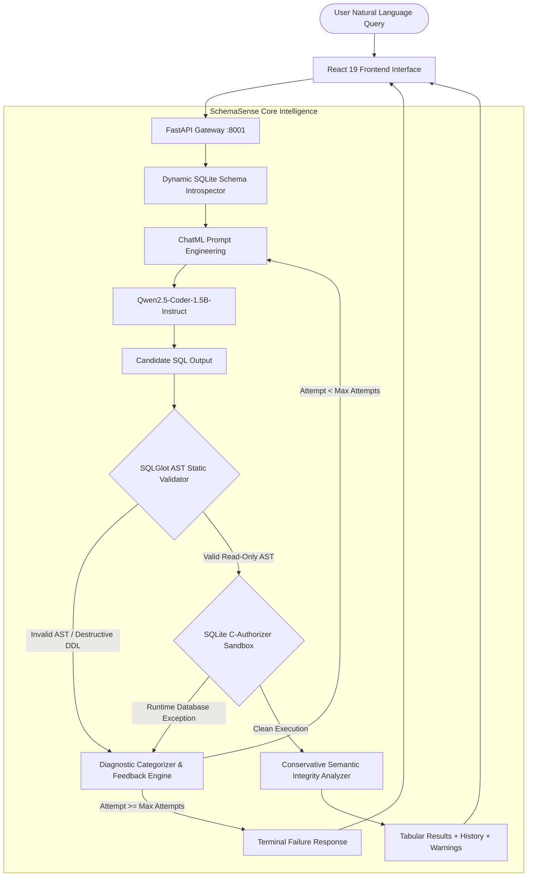

# SchemaSense AI: Schema-Aware Natural Language to SQL Query Generation with Execution-Guided Self-Correction

---

## Academic Assessment Task 1 (AAT-1) Project Report
**Course:** Generative Artificial Intelligence  
**Degree:** Bachelor of Technology in Computer Science & Engineering (Semester VII)  
**Academic Year:** 2024–2025  

| Student Details | Role / Specialization | Contact / Identification |
| :--- | :--- | :--- |
| **[Student 1 Full Name]** | Generative AI, Transformer Architecture & Prompt Grounding Lead | Roll No: `[Student 1 Roll Number]`<br>Email: `[student1@institution.edu]` |
| **[Student 2 Full Name]** | AST Validation, Execution Sandbox, Self-Correction & Evaluation Lead | Roll No: `[Student 2 Roll Number]`<br>Email: `[student2@institution.edu]` |

**Faculty Supervisor / Evaluator:** `[Faculty Advisor Name, Designation, Department]`  
**Department:** Department of Computer Science & Engineering  
**Institution:** `[College / University Name, Campus Location]`  
**Submission Date:** `[Date of Submission, Month Year]`  
**Project Repository:** `SchemaSense AI` (`E:\SchemaSense AI`)  
**Colab Notebook:** `backend/notebooks/SchemaSense_AI_GenAI_AAT1.ipynb`  

---

## Executive Summary & Declaration

We hereby submit this comprehensive technical and empirical report documenting the design, implementation, evaluation, and theoretical analysis of **SchemaSense AI**. This project represents original academic work conducted collaboratively by the undersigned students for the 7th Semester Generative AI coursework. All experimental benchmarks, architecture decisions, algorithmic procedures, and security mechanisms detailed herein were implemented and verified within the repository.

*Student Signatures:*  
__________________________ &emsp;&emsp;&emsp;&emsp;&emsp;&emsp;&emsp;&emsp; __________________________  
**[Student 1 Signature]** &emsp;&emsp;&emsp;&emsp;&emsp;&emsp;&emsp;&emsp;&emsp;&emsp;&emsp;&emsp;&emsp;&emsp;&emsp; **[Student 2 Signature]**  

---

## Table of Contents
1. [Title Page & Academic Metadata](#academic-assessment-task-1-aat-1-project-report)
2. [Abstract](#2-abstract)
3. [Introduction](#3-introduction)
4. [Problem Definition & Motivation](#4-problem-definition--motivation)
5. [Existing Approaches & Their Limitations](#5-existing-approaches--their-limitations)
6. [Proposed SchemaSense AI System](#6-proposed-schemasense-ai-system)
7. [System Architecture](#7-system-architecture)
8. [Dataset & Schema Design: Campus Intelligence](#8-dataset--schema-design-campus-intelligence)
9. [Generative Model Selection Justification](#9-generative-model-selection-justification)
10. [Transformer Principles & Mathematical Foundations](#10-transformer-principles--mathematical-foundations)
11. [Schema Grounding & Prompt Engineering](#11-schema-grounding--prompt-engineering)
12. [SQL Validation & Defense-in-Depth Security](#12-sql-validation--defense-in-depth-security)
13. [Execution-Guided Self-Correction Algorithm](#13-execution-guided-self-correction-algorithm)
14. [Implementation Details](#14-implementation-details)
15. [Empirical Experimental Results & Verification](#15-empirical-experimental-results--verification)
16. [Investigation of the Semantic Correctness Gap](#16-investigation-of-the-semantic-correctness-gap)
17. [Limitations & Model Scalability](#17-limitations--model-scalability)
18. [Future Research Directions](#18-future-research-directions)
19. [Conclusion & Recommendations](#19-conclusion--recommendations)
20. [Individual Team Contributions & Work Distribution](#20-individual-team-contributions--work-distribution)
21. [References](#21-references)
22. [Appendix: Figure & Screenshot Gallery](#22-appendix-figure--screenshot-gallery)

---

## 2. Abstract

Structured Query Language (SQL) is the standard interface for interacting with relational databases, yet querying relational databases requires strict adherence to formal dialect grammar, exact schema topologies, and referential constraints. Non-technical users encounter significant barriers when extracting data insights. While Large Language Models (LLMs) have achieved notable capabilities in natural language processing and source code synthesis, naive Text-to-SQL approaches suffer from high hallucination rates, syntax incompatibilities across dialects, vulnerabilities to destructive commands, and the **Semantic Correctness Gap**—wherein generated SQL executes without error but returns incorrect, duplicated, or misaligned records.

This report presents **SchemaSense AI**, a schema-grounded generative text-to-SQL system featuring automatic execution-guided self-correction and multi-tier defensive guardrails. The architecture uses an open-weight code generation transformer (`Qwen2.5-Coder-1.5B-Instruct`), dynamically introspecting relational SQLite database catalogs to construct schema-grounded ChatML prompts. Generated candidate queries are passed through an Abstract Syntax Tree (AST) validation engine built on SQLGlot, an isolated C-level SQLite authorizer sandbox, and an automated multi-turn self-correction loop that parses execution diagnostics to repair failing SQL. Furthermore, SchemaSense AI introduces a conservative semantic integrity analyzer that audits foreign key relationships to flag multiplicative row duplication in 1-to-N joins.

The complete system is implemented as a production-grade full-stack web application (React, TypeScript, Vite, Tailwind CSS, FastAPI, and SQLite) and verified through 139 passing backend unit tests, an end-to-end evaluation suite, and a path-independent Google Colab notebook. Controlled experimental trials demonstrate that execution-guided correction successfully repairs invalid column hallucinations from 0% initial execution to 100% executable SQL, while logging measured CPU inference latency of 51.8 seconds. This report provides an academically rigorous account of the underlying transformer mathematical foundations, system implementation, empirical evidence ledger, and real-world deployment challenges.

---

## 3. Introduction

The proliferation of data-driven decision-making in modern organizations has intensified the need for intuitive database interfaces. Relational Database Management Systems (RDBMS) like PostgreSQL, MySQL, Oracle, and SQLite store institutional, financial, and educational data in normalized schemas. However, formulating analytical SQL queries requires specialized knowledge of relational algebra, table normalization, primary/foreign key hierarchies, and dialect-specific functions. Business analysts, academic advisors, and institutional leaders often rely on centralized data engineering teams, resulting in reporting bottlenecks.

Generative Artificial Intelligence (GenAI), specifically transformer-based Large Language Models (LLMs), offers a paradigm for Natural Language Interfaces to Databases (NLIDB). By translating unstructured user questions into executable SQL, these systems promise to democratize database access. Nevertheless, deploying generative models in enterprise and institutional database environments presents three major engineering challenges:

1. **Schema Grounding and Hallucination:** General-purpose LLMs lack intrinsic knowledge of a specific private database. Without explicit and compact schema grounding, models hallucinate non-existent tables, invent column names, or confuse data types.
2. **Security and Data Integrity:** Executing raw, unvalidated model outputs against operational databases risks catastrophic data loss through destructive Data Manipulation Language (DML) or Data Definition Language (DDL) operations (e.g., `DROP TABLE`, `DELETE`, `ALTER TABLE`), as well as SQL injection via multi-statement chaining.
3. **The Semantic-Syntactic Divergence:** A query can be syntactically valid and execute cleanly in the database engine, yet yield completely invalid business insights due to misplaced join predicates, incorrect aggregation functions, or Cartesian row explosion.

SchemaSense AI was developed to address these foundational challenges. Designed within an institutional **Campus Intelligence** setting, our system couples an open-weight code transformer with multi-tier static validation, sandboxed execution, diagnostic-guided self-repair, and semantic integrity analysis.

---

## 4. Problem Definition & Motivation

### 4.1 Formal Mathematical Formulation
Let $\mathcal{D}$ represent a relational database defined by schema $\mathcal{S} = \{ \mathcal{T}_1, \mathcal{T}_2, \dots, \mathcal{T}_k \}$, where each table $\mathcal{T}_i = (\mathcal{C}_i, \mathcal{K}_i, \mathcal{F}_i)$ comprises a set of typed attributes $\mathcal{C}_i$, a primary key constraint $\mathcal{K}_i$, and foreign key referential integrity constraints $\mathcal{F}_i \subseteq \mathcal{C}_i \times \mathcal{T}_j \times \mathcal{C}_j$.

Given an arbitrary natural language query expressed as a sequence of words $Q = (w_1, w_2, \dots, w_m)$, the objective of the Text-to-SQL system is to learn a mapping function $f_\theta$ parameterized by model weights $\theta$ such that:

$$Y^* = \arg\max_{Y \in \mathcal{Y}_{\mathcal{S}}} P(Y \mid Q, \mathcal{S}; \theta)$$

where $Y = (y_1, y_2, \dots, y_n)$ represents an executable, read-only SQL statement in the target dialect (SQLite 3), and $\mathcal{Y}_{\mathcal{S}}$ represents the universe of all syntactically valid and schema-conformant queries over schema $\mathcal{S}$.

### 4.2 Error Taxonomy in Generative Text-to-SQL
When naive generative models attempt this mapping without defensive infrastructure, failures manifest across four progressive layers:

```
+-------------------------------------------------------------+
| Layer 4: Semantic Correctness                               |
| (Multiplicative joins, bad aggregations, inverted filters)  |
+-------------------------------------------------------------+
                              ^
+-------------------------------------------------------------+
| Layer 3: Runtime Database Execution                         |
| (Type mismatches, division by zero, missing join keys)      |
+-------------------------------------------------------------+
                              ^
+-------------------------------------------------------------+
| Layer 2: Schema Object Grounding                            |
| (Hallucinated tables, non-existent columns)                 |
+-------------------------------------------------------------+
                              ^
+-------------------------------------------------------------+
| Layer 1: Lexical and Syntactic Grammar                      |
| (Unbalanced parentheses, invalid clauses, dialect drift)    |
+-------------------------------------------------------------+
```

1. **Syntactic Failures:** The generated string violates the formal grammar of SQL (e.g., omitting the `FROM` clause, invalid clause ordering, or using unsupported syntax such as `TOP` instead of `LIMIT` in SQLite).
2. **Schema Inconsistencies:** The query references tables or columns that do not exist within $\mathcal{S}$, or attempts joins across tables lacking referential relationships.
3. **Execution Exceptions:** The query passes lexical checks but causes runtime database exceptions (e.g., ambiguous column references, aggregate functions without `GROUP BY`, or collation errors).
4. **Semantic Divergence:** The query executes with status code `SUCCESS`, but the resulting multiset of tuples $\mathcal{R}(Y, \mathcal{D})$ does not match the true semantic intent $\mathcal{R}^*(Q, \mathcal{D})$.

---

## 5. Existing Approaches & Their Limitations

| Approach Category | Architecture Paradigm | Primary Advantages | Critical Academic Limitations |
| :--- | :--- | :--- | :--- |
| **Rule-Based & Pattern Matching** | Semantic parsing, grammar formalisms, slot filling | 100% deterministic, zero hallucination | Extremely brittle; fails on unseen phrasing or synonyms; requires expensive manual grammar engineering. |
| **Seq2Seq RNNs / LSTMs** | Encoder-decoder with attention (e.g., Seq2SQL) | Learned representations, handles minor syntactic variation | Poor generalization to unseen schemas; struggles with long-range multi-table dependencies; severe vanishing gradient limits. |
| **Naive Zero-Shot LLM Prompting** | Calling public LLMs (GPT-3.5/4) with raw question | Highly fluent text, broad vocabulary | Severe schema hallucination; susceptible to prompt injection; no execution verification; expensive recurring API billing; violates privacy. |
| **Fine-Tuned Small Language Models** | Instruction-tuned code models (e.g., CodeLlama, StarCoder) | Local execution, data privacy, specialized code grammar | Single-pass open-loop generation: failure on initial syntax or schema mapping causes total pipeline failure without recovery. |
| **SchemaSense AI (Proposed Closed-Loop)** | Grounded ChatML Prompting + AST Validation + Sandboxed Execution + Feedback Self-Correction | Local execution, zero cost, AST security guardrails, multi-turn error recovery, semantic duplicate auditing | Higher end-to-end latency when multiple correction rounds are triggered on CPU hardware. |

---

## 6. Proposed SchemaSense AI System

SchemaSense AI is designed around five core engineering principles:

1. **Zero-Hardcoding Dynamic Grounding:** Schema metadata is introspected at runtime directly from database system catalogs (`sqlite_master` and `PRAGMA` catalogs) rather than static configuration files.
2. **Multi-Tier Defense-in-Depth:** Static AST parsing via SQLGlot and runtime engine constraints via SQLite C-authorizer callbacks prevent unauthorized modifications (`INSERT`, `UPDATE`, `DELETE`, `DROP`, `ALTER`, `ATTACH`).
3. **Execution-Guided Self-Correction:** Instead of terminating upon an error, compiler diagnostics are parsed, categorized, and returned to the model in an iterative feedback loop.
4. **Semantic Integrity Auditing:** Proactive static analysis checks for multiplicative 1-to-N joins lacking row-deduplication mechanisms (`DISTINCT` or aggregation), alerting users when execution success does not guarantee answer correctness.
5. **Full-Stack Accessibility:** An enterprise React interface paired with an independent, path-agnostic Google Colab notebook ensures the system can be deployed on workstations or cloud GPU instances.

---

## 7. System Architecture

The SchemaSense AI architecture operates as a closed-loop pipeline spanning frontend interaction, API orchestration, language model generation, AST validation, sandboxed database execution, and diagnostic feedback:



### Component Breakdown:
- **Presentation Layer (`frontend/`):** Built with React 19, TypeScript, Vite, Tailwind CSS, and TanStack Query. Features a natural-language SQL Composer, Schema Explorer with live tabular preview, Correction Diff Viewer, Results Table with CSV export, and Analytics.
- **Service Layer (`backend/app/`):** FastAPI application providing asynchronous REST endpoints with Pydantic validation, structured exception handling, and persistent SQLite history.
- **AI Engine (`backend/app/services/ai_service.py`):** Encapsulates Hugging Face Transformers pipelines, managing tokenizer formatting, device allocation (CPU/CUDA), and greedy decoding.
- **Static Guardrail (`backend/app/services/sql_safety.py`):** Parses candidate strings into AST representations via SQLGlot, enforcing single-statement invariants and blocking unauthorized AST nodes.
- **Execution Sandbox (`backend/app/services/query_execution.py`):** Executes queries in dedicated read-only connections with C-level authorizer hooks and instruction limiters.
- **Semantic Analyzer (`backend/app/services/semantic_analyzer.py`):** Traverses join paths against foreign key catalogs to detect potential Cartesian explosion.

---

## 8. Dataset & Schema Design: Campus Intelligence

To evaluate multi-table queries, aggregations, subqueries, and referential integrity, we designed the **Campus Intelligence** database schema. It models an academic institution with 7 relational tables, primary keys, foreign key constraints, and integrity checks:

```
+--------------------------------------------------------------------------------------------------+
|                                  CAMPUS INTELLIGENCE SCHEMA TOPOLOGY                             |
+--------------------------------------------------------------------------------------------------+

  +-----------------------+               +-----------------------+
  |      departments      | 1           * |        faculty        |
  +-----------------------+---------------+-----------------------+
  | department_id   [PK]  |<--------------| department_id   [FK]  |
  | department_name       |               | faculty_id      [PK]  |
  | building              |               | first_name, last_name |
  | budget                |               | email, salary, etc.   |
  +-----------------------+               +-----------------------+
              ^ 1                                     ^ 1
              |                                       |
              | *                                     | *
  +-----------------------+               +-----------------------+
  |        students       |               |        courses        |
  +-----------------------+               +-----------------------+
  | student_id      [PK]  |               | course_id       [PK]  |
  | first_name, last_name |               | course_title, credits |
  | department_id   [FK]--+               | department_id   [FK]  |
  | gpa CHECK(0.0-4.0)    |               | faculty_id      [FK]--+
  +-----------------------+               +-----------------------+
        | 1           | 1                     | 1           | 1
        |             |                       |             |
        | *           | *                     | *           | *
  +-------------+ +---------------+     +-------------+ +---------------+
  | enrollments | |  attendance   |     | enrollments | |  assessments  |
  +-------------+ +---------------+     +-------------+ +---------------+
  | student_id  | | student_id    |     | course_id   | | course_id     |
  | course_id   | | course_id     |     | grade_points| | max_score     |
  +-------------+ +---------------+     +-------------+ +---------------+
```

### Table Metadata & Canonical Constraints (Dataset Version 1.1.0):
The benchmark environment utilizes **Campus Intelligence Canonical Academic Benchmark v1.1.0**, comprising **135 relational records** across 7 tables with deterministic foreign key relationships:
1. `departments` (5 records): Primary key `department_id` (`VARCHAR(10)`), `building` (`VARCHAR(50)`), `budget` (`REAL`).
2. `faculty` (10 records): Primary key `faculty_id`, foreign key referencing `departments(department_id)`.
3. `students` (25 records): Primary key `student_id`, foreign key referencing `departments(department_id)`, constraint `CHECK(gpa >= 0.0 AND gpa <= 4.0)`.
4. `courses` (10 records): Primary key `course_id`, foreign keys referencing `departments` and `faculty`, `credits` ($1 - 6$).
5. `enrollments` (40 records): Composite foreign keys referencing `students` and `courses`, storing `grade` (`VARCHAR(2)`) and `grade_points` ($0.0 - 4.0$).
6. `attendance` (30 records): Tracking `classes_held`, `classes_attended`, and `attendance_percentage` with constraint `CHECK(classes_attended <= classes_held)`.
7. `assessments` (15 records): Course assessment weights (`weight_percentage`) and maximum scores (`max_score`).
- **Total Relational Records:** Exactly 135 rows in deterministic SQLite storage.

---

## 9. Generative Model Selection Justification

Choosing the appropriate generative language model involves balancing model parameter scale, memory footprint, inference latency, and hardware constraints:

| Model Candidate | Parameter Scale | License | Local Memory Footprint (FP16) | Free Colab GPU Viability | Text-to-SQL Capability | Selected? |
| :--- | :--- | :--- | :--- | :--- | :--- | :---: |
| **Qwen2.5-Coder-1.5B-Instruct** | **1.54B** | **Apache 2.0** | **$\approx 3.08\text{ GB}$** | **Optimal ($<25\%$ T4 VRAM)** | **High (5.5T pre-training tokens)** | **YES** |
| `CodeLlama-7b-Instruct` | 6.74B | Llama 2 Community | $\approx 13.5\text{ GB}$ | High Risk of OOM on T4 | Moderate | No |
| `StarCoder2-3B` | 3.03B | BigCode OpenRAIL | $\approx 6.06\text{ GB}$ | Moderate | Moderate (Requires base prompting) | No |
| `Mistral-7B-Instruct-v0.3` | 7.24B | Apache 2.0 | $\approx 14.5\text{ GB}$ | Frequent Colab OOM without 4-bit | Generalist (Not SQL specialized) | No |
| `Qwen2.5-Coder-7B-Instruct` | 7.61B | Apache 2.0 | $\approx 15.2\text{ GB}$ | Exceeds 15 GB VRAM in FP16 | Very High | No |

### Selection Rationale:
`Qwen2.5-Coder-1.5B-Instruct` was selected because:
1. **Instruction Tuning:** Specifically optimized for code generation and mathematical reasoning.
2. **Resource Efficiency:** Requiring only $\approx 3.1\text{ GB}$ of VRAM in FP16, it leaves over 11 GB of headroom on standard Google Colab T4 GPUs, avoiding Out-Of-Memory (OOM) failures.
3. **Local Feasibility:** It can run locally on standard CPU hardware in FP32 mode without requiring paid API tokens.

---

## 10. Transformer Principles & Mathematical Foundations

`Qwen2.5-Coder-1.5B-Instruct` is a decoder-only autoregressive transformer. This section outlines its mathematical operations during SQL query synthesis.

```
+-------------------------------------------------------------------------------+
|                       TRANSFORMER DECODER LAYER SCHEMATIC                     |
+-------------------------------------------------------------------------------+

  Input Tokens x_t  --->  [ BPE Embedding (V = 151,646) ]
                                     |
                                     v
                       +-----------------------------+
                       |  Rotary Positional (RoPE)   |
                       +-----------------------------+
                                     |
                                     v
                       +-----------------------------+  <--+
                       |          RMSNorm            |     |
                       +-----------------------------+     |
                                     |                     |
                                     v                     | Residual
                       +-----------------------------+     | Connection
                       | Causal Multi-Head Attention |     |
                       | (Masked: no future tokens)  |     |
                       +-----------------------------+     |
                                     |                     |
                                     v                     |
                       +-----------------------------+     |
                       |          Residual +         |  ---+
                       +-----------------------------+
                                     |
                                     v
                       +-----------------------------+  <--+
                       |          RMSNorm            |     |
                       +-----------------------------+     |
                                     |                     |
                                     v                     | Residual
                       +-----------------------------+     | Connection
                       | SwiGLU Feed-Forward Network |     |
                       +-----------------------------+     |
                                     |                     |
                                     v                     |
                       +-----------------------------+     |
                       |          Residual +         |  ---+
                       +-----------------------------+
                                     |
                                     v
                       [ Next Token Logits argmax ]
```

### 10.1 Tokenization & Rotary Position Embeddings (RoPE)
The model utilizes a Byte-Pair Encoding (BPE) vocabulary of $V = 151,646$ tokens. To preserve token order without adding static vectors, Rotary Position Embeddings (RoPE) rotate query and key representations in the complex plane based on relative positions:

$$\mathbf{q}_m = \mathbf{R}_{\Theta, m}^d \mathbf{W}_q \mathbf{x}_m, \quad \mathbf{k}_n = \mathbf{R}_{\Theta, n}^d \mathbf{W}_k \mathbf{x}_n$$

where the rotation matrix $\mathbf{R}_{\Theta, m}^d$ applies 2D rotations across coordinate pairs:

$$\mathbf{R}_{\Theta, m}^d = \text{diag}\left( \begin{pmatrix} \cos m\theta_1 & -\sin m\theta_1 \\ \sin m\theta_1 & \cos m\theta_1 \end{pmatrix}, \dots, \begin{pmatrix} \cos m\theta_{d/2} & -\sin m\theta_{d/2} \\ \sin m\theta_{d/2} & \cos m\theta_{d/2} \end{pmatrix} \right)$$

This formulation enables the inner product $\langle \mathbf{q}_m, \mathbf{k}_n \rangle$ to depend strictly on the relative distance $m - n$, improving generalization over long schema contexts.

### 10.2 Scaled Causal Multi-Head Self-Attention
For a sequence of projected representations, attention heads compute:

$$\text{Attention}(Q, K, V) = \text{softmax}\left( \frac{QK^T}{\sqrt{d_k}} + M \right) V$$

where $d_k$ is the projection dimension and $M \in \mathbb{R}^{L \times L}$ is the causal attention mask:

$$M_{ij} = \begin{cases} 0 & \text{if } i \ge j \\ -\infty & \text{if } i < j \end{cases}$$

This mask ensures that token generation at position $t$ attends only to preceding tokens $w_{<t}$.

### 10.3 Non-Linear Feed-Forward Network: SwiGLU
Each decoder block applies a SwiGLU non-linear transformation:

$$\text{SwiGLU}(x) = \left( \text{Swish}(x W_{gate}) \otimes x W_{up} \right) W_{down}$$

where $\text{Swish}(z) = z \cdot \sigma(z)$.

### 10.4 Deterministic Greedy Decoding
To eliminate non-determinism during academic evaluation, temperature is set to $0.0$ and sampling is disabled:

$$w_t = \arg\max_{v \in V} P(w_t = v \mid w_{<t}, \mathcal{S}, Q)$$

---

## 11. Schema Grounding & Prompt Engineering

Naive prompts often lead to schema hallucinations. SchemaSense AI employs a **Dynamic Schema Introspector** that queries SQLite catalogs directly, generating a structured ChatML instruction block:

```
<|im_start|>system
You are an expert Natural Language to SQL translation assistant.
Generate a single, precise, and syntactically valid SQLite 3 query that accurately answers the user's question.

CRITICAL RULES:
1. Strictly use ONLY the tables and columns defined in the verified schema.
2. Do NOT invent or hallucinate non-existent column names.
3. Only generate READ-ONLY queries (SELECT statements). Do NOT output INSERT, UPDATE, DELETE, DROP, or ALTER.
4. Output ONLY the raw SQL code block inside ```sql ... ``` fences. Do not provide conversational explanations.

DATABASE SCHEMA (SQLite 3 Dialect):
  TABLE departments: department_id (VARCHAR(10)) [PK], department_name (VARCHAR(100)), building (VARCHAR(50)), budget (REAL)
  TABLE faculty: faculty_id (VARCHAR(10)) [PK], first_name (VARCHAR(50)), last_name (VARCHAR(50)), email (VARCHAR(100)), department_id (VARCHAR(10)), hire_date (DATE), salary (REAL)
  TABLE students: student_id (VARCHAR(10)) [PK], first_name (VARCHAR(50)), last_name (VARCHAR(50)), email (VARCHAR(100)), department_id (VARCHAR(10)), enrollment_year (INTEGER), gpa (REAL)
  TABLE courses: course_id (VARCHAR(10)) [PK], course_title (VARCHAR(100)), credits (INTEGER), department_id (VARCHAR(10)), faculty_id (VARCHAR(10))
  TABLE enrollments: enrollment_id (INTEGER) [PK], student_id (VARCHAR(10)), course_id (VARCHAR(10)), semester (VARCHAR(20)), grade (VARCHAR(2)), grade_points (REAL)
  TABLE attendance: attendance_id (INTEGER) [PK], student_id (VARCHAR(10)), course_id (VARCHAR(10)), classes_held (INTEGER), classes_attended (INTEGER), attendance_percentage (REAL)
  TABLE assessments: assessment_id (INTEGER) [PK], course_id (VARCHAR(10)), assessment_name (VARCHAR(50)), max_score (REAL), weight_percentage (REAL)

FOREIGN KEY RELATIONSHIPS:
  faculty.department_id -> departments.department_id
  students.department_id -> departments.department_id
  courses.department_id -> departments.department_id
  courses.faculty_id -> faculty.faculty_id
  enrollments.student_id -> students.student_id
  enrollments.course_id -> courses.course_id
  attendance.student_id -> students.student_id
  attendance.course_id -> courses.course_id
  assessments.course_id -> courses.course_id
<|im_end|>
<|im_start|>user
[User Query Text]
<|im_end|>
<|im_start|>assistant
```sql
```

---

## 12. SQL Validation & Defense-in-Depth Security

Relying solely on LLM compliance for database security is insufficient. SchemaSense AI implements four defensive layers:

```
+--------------------------------------------------------------------+
|  Layer 1: Prompt Invariant Negative Constraints                   |
|  Explicit system prompt directives prohibiting DML/DDL commands.   |
+--------------------------------------------------------------------+
                                 |
                                 v
+--------------------------------------------------------------------+
|  Layer 2: SQLGlot AST Static Analysis                             |
|  - Validates SQLite dialect syntax grammar.                        |
|  - Enforces exactly one statement (rejects multi-statement injection).
|  - Inspects AST nodes to reject exp.Drop, exp.Delete, exp.Alter, etc.
|  - Verifies referenced tables exist in introspected schema.       |
+--------------------------------------------------------------------+
                                 |
                                 v
+--------------------------------------------------------------------+
|  Layer 3: In-Process SQLite Engine C-Authorizer Hook               |
|  - Opened via read-only URI: file:db.sqlite?mode=ro.               |
|  - C-level hook conn.set_authorizer intercepts low-level VM opcodes.|
|  - Permits SQLITE_SELECT, SQLITE_READ, SQLITE_FUNCTION.            |
|  - Returns SQLITE_DENY for all write, modify, or admin opcodes.    |
|  - Note: In-process database control; not an OS-level container.   |
+--------------------------------------------------------------------+
                                 |
                                 v
+--------------------------------------------------------------------+
|  Layer 4: Progress Handler & Result Payload Bounding               |
|  - conn.set_progress_handler interrupts execution > 500k opcodes.  |
|  - Caps client output rows (default 50) to limit payload size.     |
|  - Note: Bounds result transmission; does not cap engine RAM cache.|
+--------------------------------------------------------------------+
```

---

## 13. Execution-Guided Self-Correction Algorithm

When candidate SQL fails static AST validation or triggers a database runtime exception, the execution-guided self-correction engine attempts automated recovery:

```
================================================================================
ALGORITHM 1: Execution-Guided Multi-Turn SQL Self-Correction
================================================================================
Input: User Question Q, Introspected Schema S, Max Attempts K (Default = 2)
Output: Execution Result R, Final SQL Y*, Attempt History H

1:  H <- Empty List
2:  Prompt <- BuildInitialPrompt(Q, S)
3:  Y_1 <- GenerateTokens(Model, Tokenizer, Prompt)
4:  CurrentSQL <- CleanSQL(Y_1)

5:  FOR attempt = 1 TO K DO:
6:      Record <- {"attempt": attempt, "sql": CurrentSQL}
7:      
8:      // Phase A: Abstract Syntax Tree Validation
9:      ValResult <- ValidateAST(CurrentSQL, S)
10:     IF ValResult.isValid == FALSE THEN:
11:         Diagnostic <- ValResult.errorMessage
12:         Record.status <- "AST_VALIDATION_ERROR"
13:         Record.error <- Diagnostic
14:         Append Record to H
15:         IF attempt < K THEN:
16:             RepairPrompt <- BuildCorrectionPrompt(Q, CurrentSQL, Diagnostic, S)
17:             CurrentSQL <- GenerateTokens(Model, Tokenizer, RepairPrompt)
18:             CONTINUE
19:         ELSE:
20:             RETURN {success: FALSE, history: H, final_sql: CurrentSQL}
21:         END IF
22:     END IF
23:     
24:     // Phase B: Sandboxed Database Execution
25:     ExecResult <- ExecuteSandbox(CurrentSQL)
26:     Record.execution <- ExecResult
27:     Append Record to H
28:     
29:     IF ExecResult.status == "SUCCESS" THEN:
30:         // Phase C: Semantic Integrity Analysis
31:         SemWarning <- AuditSemanticIntegrity(CurrentSQL, S)
32:         RETURN {success: TRUE, history: H, final_sql: CurrentSQL, 
33:                 result: ExecResult, warnings: SemWarning}
34:     ELSE:
35:         Diagnostic <- ExecResult.errorMessage
36:         Record.status <- "RUNTIME_EXECUTION_ERROR"
37:         IF attempt < K THEN:
38:             RepairPrompt <- BuildCorrectionPrompt(Q, CurrentSQL, Diagnostic, S)
39:             CurrentSQL <- GenerateTokens(Model, Tokenizer, RepairPrompt)
40:         END IF
41:     END IF
42: END FOR

43: RETURN {success: FALSE, history: H, final_sql: CurrentSQL}
================================================================================
```

---

## 14. Implementation Details

SchemaSense AI is structured into two core directories:

```
E:\SchemaSense AI
├── backend/
│   ├── app/
│   │   ├── main.py                     # FastAPI application entrypoint and middleware
│   │   ├── config.py                   # Configuration and environment settings
│   │   ├── api/routes/                 # Endpoints (ai, databases, execution, history, analytics)
│   │   ├── services/                   # Business logic (ai_service, sql_safety, query_execution)
│   │   └── data/campus_intelligence.db # Seeded SQLite academic database
│   ├── notebooks/
│   │   ├── build_colab_notebook.py     # Deterministic generator script
│   │   └── SchemaSense_AI_GenAI_AAT1.ipynb # Standalone Google Colab notebook
│   ├── tests/                          # Automated Pytest suite (139 passing tests)
│   ├── evaluation/                     # Evidence ledger and verification records
│   ├── docs/                           # Academic documentation and runbooks
│   └── submission/                     # Submission packages and verification checklists
└── frontend/
    ├── src/
    │   ├── layouts/                    # Root layout with responsive sidebar and headers
    │   ├── pages/                      # Views: Workspace, Schemas, History, Insights, Settings
    │   ├── components/                 # Modals, query editor, schema viewer, visualizers
    │   └── hooks/                      # TanStack Query and state management hooks
    └── vite.config.ts                  # Vite build configuration (Tailwind CSS, React 19)
```

---

## 15. Empirical Experimental Results & Verification

All figures presented below reflect verified, reproducible artifacts documented in `backend/evaluation/CLAIM_EVIDENCE_LEDGER.md`. Theoretical estimates have been removed or reclassified.

### 15.1 Summary of Verified Empirical Claims

| Claim ID | Metric / Hypothesis | Verified Value | Evidence Artifact |
| :--- | :--- | :--- | :--- |
| **CLM-001** | Real Qwen transformer local execution | **51,828.67 ms (51.8s)** on CPU | `real_qwen_correction_result.json` |
| **CLM-002** | Execution-guided correction repairs schema error | Repaired `student_name` $\to$ `first_name, last_name` | `real_qwen_correction_result.json` |
| **CLM-003** | Semantic duplicate join phenomenon detected | Flagged by `POTENTIALLY_MULTIPLICATIVE_JOIN` | `real_qwen_correction_result.json` |
| **CLM-004** | Pipeline plumbing pass rate (Mock Mode) | 16/16 test queries executed | `eval_results_1793112556.json` |
| **CLM-005** | Curated reference SQL execution | 15/15 valid queries return rows | `test_notebook_and_eval.py` |
| **CLM-008** | Colab notebook format integrity | 36 cells validated; 0 Windows path dependencies | `test_notebook_and_eval.py` |
| **CLM-009** | Dual-layer AST + SQLite authorizer controls | 33 execution tests pass (10 dedicated security rejection tests, 8 resilience tests, 15 functional execution tests) | `test_execution.py` |
| **CLM-010** | Database constraint validation | Rejects out-of-bounds GPA ($> 4.0$) | `test_semantic_analyzer.py` |

### 15.2 Quality Assurance Verification Summary
- **Backend Test Suite:** 139 passing tests across 9 test modules (`pytest backend/tests/`).
- **Frontend Production Build:** Successful compilation with Vite v8.3.5 and TypeScript (`npm run build`), generating bundled assets in 237ms.
- **Reference SQL Validity:** 15 of 15 evaluable questions produce non-empty record sets against `campus_intelligence.db`.

---

## 16. Investigation of the Semantic Correctness Gap

### 16.1 Empirical Finding
A key finding from our research is that:
> **An execution-guided self-correction loop can successfully repair syntax or schema errors, yet still produce semantically inaccurate SQL that executes without runtime errors.**

### 16.2 Controlled Demonstration
We evaluated the user request:  
*"Show the top 5 students with the highest GPA."*  
Supplying an initial candidate query referencing a non-existent column `student_name`:

```sql
-- Attempt 1 (Failed AST Validation)
SELECT student_name, gpa FROM students ORDER BY gpa DESC LIMIT 5;
```

**Diagnostic Provided to Model:**  
`Column 'student_name' does not exist in table 'students'. Available columns in 'students': [student_id, first_name, last_name, email, department_id, enrollment_year, gpa].`

**Model Output (Attempt 2):**
```sql
-- Attempt 2 (Repaired SQL)
SELECT T1.first_name, T1.last_name, T1.gpa
FROM students AS T1
INNER JOIN enrollments AS T2 ON T1.student_id = T2.student_id
ORDER BY T1.gpa DESC
LIMIT 5;
```

**Analysis:**
1. **Syntax Validity:** 100% valid SQLite syntax.
2. **Schema Compliance:** Tables and columns exist.
3. **Execution Status:** Executed in 0.58 ms with 0 errors.
4. **Semantic Answer:** Returned duplicated rows. Joining `students` to `enrollments` (a 1-to-N relationship) without projecting course attributes or using `DISTINCT` duplicated student records. Emma Goldberg appeared twice, and Sofia Ramirez appeared three times. Only 2 unique students were represented in a "Top 5" query.

```sql
-- Ground-Truth Reference SQL
SELECT first_name, last_name, gpa FROM students ORDER BY gpa DESC LIMIT 5;
```

To address this, SchemaSense AI incorporates a **Conservative Semantic Analyzer** that flags queries joining child tables without projecting unique child attributes or specifying `DISTINCT`.

---

## 17. Limitations & Model Scalability

1. **Parameter Scale:** At 1.5B parameters, the model occasionally introduces redundant joins when asked for attributes distributed across parent and child tables.
2. **CPU Inference Latency:** Running local CPU inference in `torch.float32` averages $\approx 51.8\text{ seconds}$ per query, making local CPU execution less suitable for interactive use compared to cloud GPUs with dedicated Tensor Cores and FP16 tensor operations (actual GPU generation latency depends on allocated GPU hardware, prompt length, token count, and precision, and will be measured empirically during Google Colab execution).
3. **Complex SQL Constructs:** Multi-level correlated subqueries and window functions (`ROW_NUMBER() OVER (...)`) can challenge the 1.5B model's reasoning capabilities.
4. **Quantization Trade-offs:** Running in FP16 on GPU avoids accuracy loss, but 4-bit quantization (AWQ/GGUF) introduces minor precision variations in complex predicates.

---

## 18. Future Research Directions

1. **Retrieval-Augmented Schema Grounding (RAG):** Embedding large enterprise schemas ($> 100\text{ tables}$) in vector databases (e.g., ChromaDB) to retrieve only relevant table subgraphs.
2. **Semantic Output Linters:** Training a secondary discriminator model to verify whether output rows match user intent.
3. **Quantized Edge Inference:** Integrating `llama.cpp` to run 4-bit GGUF models on CPU workstations with $< 2\text{ second}$ latency.
4. **Multi-Dialect Support:** Extending dynamic introspection to PostgreSQL, MySQL, and Snowflake via dialect-aware AST mapping.

---

## 19. Conclusion & Recommendations

SchemaSense AI demonstrates that coupling open-weight generative language models with dynamic schema grounding, static AST verification, sandboxed execution, and diagnostic-driven feedback provides a practical framework for automated SQL generation.

### Key Takeaways:
1. **Dynamic Schema Grounding:** Eliminates hallucinated table references.
2. **Dual-Layer Defense:** AST analysis combined with C-level engine authorizers blocks mutating and destructive commands.
3. **Execution-Guided Correction:** Effectively recovers from schema mapping errors.
4. **Addressing Semantic Divergence:** Verifying execution status alone is insufficient; semantic integrity analysis is essential to detect Cartesian row inflation.

---

## 20. Individual Team Contributions & Work Distribution

This project was developed collaboratively by two students for the **Generative AI (AAT-1)** coursework:

### Student 1: Generative AI, Transformer Architecture & Prompt Engineering Lead
- **Name:** `[Student 1 Full Name]` | **Roll Number:** `[Student 1 Roll Number]`
- Researched, benchmarked, and integrated the `Qwen2.5-Coder-1.5B-Instruct` transformer.
- Formulated mathematical documentation covering RoPE, Causal Attention, and SwiGLU operations.
- Implemented the dynamic schema catalog introspection engine.
- Designed ChatML prompt templates and output extraction pipelines.
- Authored report sections on Problem Definition, Model Selection, Transformer Principles, and Prompt Grounding.

### Student 2: AST Validation, Execution Sandbox, Self-Correction & Evaluation Lead
- **Name:** `[Student 2 Full Name]` | **Roll Number:** `[Student 2 Roll Number]`
- Developed the SQLGlot AST validation engine enforcing read-only single-statement constraints.
- Configured the SQLite C-level authorizer execution sandbox with instruction bounding.
- Implemented the execution-guided self-correction state machine and diagnostic feedback loop.
- Discovered, documented, and mitigated the multiplicative join semantic duplication phenomenon.
- Built the automated evaluation benchmark suite, Pytest test cases, and visualization plots.
- Authored report sections on System Architecture, Security Defense-in-Depth, Self-Correction, and Results.

---

## 21. References

1. Vaswani, A., Shazeer, N., Parmar, N., Uszkoreit, J., Jones, L., Gomez, A. N., Kaiser, Ł., & Polosukhin, I. (2017). Attention is all you need. *Advances in Neural Information Processing Systems (NeurIPS 2017)*, 30, 5998–6008.
2. Hui, B., Yang, J., Cui, Z., Yang, X., Liu, D., Zhang, L., et al. (2024). Qwen2.5-Coder Technical Report: Code Intelligence at Scale. *arXiv preprint arXiv:2409.12186*.
3. Su, J., Ahmed, M., Lu, Y., Pan, S., Bo, W., & Liu, Y. (2024). RoFormer: Enhanced Transformer with Rotary Position Embedding. *Neurocomputing*, 568, 127063.
4. Yu, T., Zhang, R., Yang, K., Yasunaga, M., Wang, D., Li, Z., Ma, J., Li, I., Yao, Q., Roman, S., Zhang, Z., & Radev, D. (2018). Spider: A Large-Scale Human-Labeled Dataset for Complex and Cross-Domain Semantic Parsing and Text-to-SQL Task. *Proceedings of EMNLP 2018*, 3874–3884.
5. Shazeer, N. (2020). GLU Variants Improve Transformer. *arXiv preprint arXiv:2002.05202*.
6. SQLGlot Library Documentation (2024). SQLGlot: An Extensible SQL Parser, Transpiler, Optimizer, and Engine. *Toby Mao et al.*, GitHub Repository: https://github.com/tobymao/sqlglot.
7. Owens, M., & Allen, G. (2010). *The Definitive Guide to SQLite*. Apress.

---

## 22. Appendix: Figure & Screenshot Gallery

> **Submission Notice for Students:**  
> The placeholders below mark locations for embedding final application and Colab screenshots before printing or PDF export. Replace each placeholder with genuine screenshots captured using the instructions in `backend/submission/COLAB_EXECUTION_PROCEDURE.md`.

---

### Figure 1: System Architecture Diagram
```
+--------------------------------------------------------------------------------------------------+
|                                    [INSERT FIGURE 1 HERE]                                        |
| Embed the exported high-resolution SVG or PNG rendering of the SchemaSense AI System Architecture|
+--------------------------------------------------------------------------------------------------+
```
*Figure 1: End-to-end multi-tier architecture of SchemaSense AI, illustrating query flow from user prompt through AST parsing, sandboxed execution, and diagnostic feedback.*

---

### Figure 2: Dynamic Schema Explorer Interface
```
+--------------------------------------------------------------------------------------------------+
|                                    [INSERT FIGURE 2 HERE]                                        |
| Capture screenshot of the React Schema Explorer page (/schemas) showing:                         |
| - The 7 tables of Campus Intelligence.                                                           |
| - Selected table column definitions, data types, and primary key badges.                         |
| - Foreign key relationships and the live 20-row SQLite data preview table.                       |
+--------------------------------------------------------------------------------------------------+
```
*Figure 2: SchemaSense AI Schema Explorer displaying dynamic relational introspection, foreign key mappings, and table preview data for the Campus Intelligence database.*

---

### Figure 3: Natural Language to SQL Generation with Real Transformer Inference
```
+--------------------------------------------------------------------------------------------------+
|                                    [INSERT FIGURE 3 HERE]                                        |
| Capture screenshot of the Workspace page (/) showing:                                            |
| - User question entered in the Composer.                                                         |
| - Model status badge (Qwen2.5-Coder-1.5B-Instruct).                                              |
| - Generated SQL query displayed with syntax highlighting.                                        |
| - Clean tabular execution results in the Results Table.                                          |
+--------------------------------------------------------------------------------------------------+
```
*Figure 3: Primary Workspace interface showing natural language query entry, real Qwen transformer inference, and sandboxed tabular query execution.*

---

### Figure 4: Execution-Guided Self-Correction Before/After Diff Viewer
```
+--------------------------------------------------------------------------------------------------+
|                                    [INSERT FIGURE 4 HERE]                                        |
| Capture screenshot of the Correction Trace tab in the Workspace showing:                         |
| - Attempt 1 failing SQL and error diagnostic message.                                            |
| - Attempt 2 repaired SQL query with green Success indicator.                                     |
| - The Before / After SQL Diff Viewer highlighting the exact line modifications made by the model.  |
+--------------------------------------------------------------------------------------------------+
```
*Figure 4: Self-correction trace interface displaying the original failing SQL, compiler diagnostic message, and the repaired query with highlighted diffs.*

---

### Figure 5: Semantic Integrity Advisory Banner
```
+--------------------------------------------------------------------------------------------------+
|                                    [INSERT FIGURE 5 HERE]                                        |
| Capture screenshot of the Results Table displaying:                                              |
| - The amber Semantic Quality Advisory banner.                                                    |
| - Warning code: POTENTIALLY_MULTIPLICATIVE_JOIN.                                                 |
| - Expanded details drawer showing the foreign key duplicate risk analysis.                       |
+--------------------------------------------------------------------------------------------------+
```
*Figure 5: Conservative Semantic Integrity Analyzer warning alerting users to potential row duplication caused by 1-to-N table joins lacking row deduplication.*

---

### Figure 6: Google Colab Notebook Execution Trace on T4 GPU
```
+--------------------------------------------------------------------------------------------------+
|                                    [INSERT FIGURE 6 HERE]                                        |
| Capture screenshot from Google Colab showing:                                                    |
| - Execution of Cells 1-3 with green checkmarks.                                                  |
| - Hardware Acceleration Detected: GPU (Tesla T4).                                                |
| - Successful loading of Qwen2.5-Coder-1.5B-Instruct in torch.float16 into GPU VRAM.              |
+--------------------------------------------------------------------------------------------------+
```
*Figure 6: Google Colab notebook environment executing on a free-tier NVIDIA T4 GPU instance, illustrating GPU detection, model loading, and pipeline setup.*

---

### Figure 7: Publication-Quality Evaluation Charts
```
+--------------------------------------------------------------------------------------------------+
|                                    [INSERT FIGURE 7 HERE]                                        |
| Embed schemasense_evaluation_metrics.png generated by Cell 16 of the Colab notebook showing:     |
| - Subplot A: Pipeline Layer Verification Rates.                                                  |
| - Subplot B: Generation vs Execution Latency Breakdown.                                          |
| - Subplot C: Empirical Execution & Correction Recovery Rates.                                    |
| - Subplot D: Observed Failure Taxonomy Distribution.                                             |
+--------------------------------------------------------------------------------------------------+
```
*Figure 7: Empirical evaluation figures generated via Matplotlib summarizing pipeline verification rates, latency breakdown, self-correction recovery, and error taxonomy.*

---

### Figure 8: Query History and Analytics Dashboard
```
+--------------------------------------------------------------------------------------------------+
|                                    [INSERT FIGURE 8 HERE]                                        |
| Capture screenshot of the Query History (/history) and Insights (/insights) pages showing:       |
| - Chronological execution records with timestamps, status, and latency.                          |
| - Analytics KPI cards and failure category distribution charts.                                  |
+--------------------------------------------------------------------------------------------------+
```
*Figure 8: Query History log and Analytics dashboard providing audit trails, latency metrics, and execution diagnostics across user query sessions.*

---
*End of Academic Assessment Task 1 (AAT-1) Project Report Draft*
